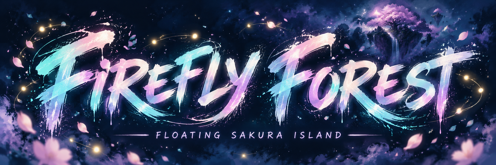

# Firefly Forest — Floating Sakura Island

A procedural Three.js night diorama: a sakura grove on a floating asteroid, surrounded by translucent water, stars, drifting mist and interactive fireflies.

[Live scene](https://agouti-ar.github.io/firefly-forest/)

[Optional soundtrack prompts](MUSIC-PROMPTS.md) — three music directions to explore; the current scene uses its nature ambience.

## Scene

- Irregular faceted rock underside, downward shards, soil and moss shore.
- Tapered roots, dense trailing vines, ferns and an orbiting cloud of differently sized rock fragments.
- Cold moonlight, blue fill, a restrained amber underside rim from the nebula side, and a soft crown-light lift during zodiac formations.
- HDR firefly and mushroom glow through UnrealBloomPass; OutputPass handles the final tone mapping.
- Translucent wind-driven water, two moving ripple scales and circular wakes. Desktop water also uses a one-time environment reflection capture; light highlights and waves remain animated.
- Two swimming koi, twenty floating leaves and ten open water-lily blooms (sixteen/eight on compact devices), and two breathing frogs that occasionally hop. Fish contact shadows stay directly beneath them.
- Optional Web Audio ambience uses CC0 field recordings of insects and frogs, a stream, and rare owl calls, with wind and splash effects synchronized with koi jumps. Recordings load only after enabling sound; synthesized ambience remains a fallback. The English Sound on/off control includes a volume slider, remembers volume, and supports touch screens. Audio starts off and pauses in background tabs. See AUDIO-CREDITS.md for sources.
- Airy ground mist disperses below the island edges. A cratered moon with dark maria and a soft halo completes an artistic phase cycle in 90 seconds and drifts around the sky in eight minutes. Its light direction and shadows follow its movement.
- A world-fixed, one-sided cosmic horizon mixes muted amber cliffs, smoky carmine, indigo and a faint diagonal dust band. The upper sky stays dark blue. Its texture is baked once at startup. A shooting star with a soft head and tapered luminous ribbon appears for 2.6 seconds every sixteen seconds, starting five seconds after loading. Each launch selects an upper corner of the current view, then follows a fixed world path; reduced-motion mode disables it.
- A large distant black hole uses an opaque 3D sphere, a tilted translucent annulus and orbiting cyan/lilac/rose particles. A local lens shader bends a one-time sky cubemap capture around the horizon, with a soft photon ring and a secondary disk arc. This is an artistic lensing approximation, not a general-relativistic ray tracer. Foreground island geometry remains sharp and undistorted. Append `blackhole=0` to the URL to compare without the effect.
- A 137-second firefly cycle opens with a luminous koi, then morphs through all twelve zodiac glyphs, eight seconds per sign, before dispersing. Descent finishes at second 126; the next ascent starts four seconds into the following cycle, leaving fifteen seconds of rest in the grove. Captions resolve from soft focus during the last 0.7 seconds of each 2.5-second morph, then stay pixel-aligned and still. Changes are hidden by fades. A few low fireflies on the nebula side have amber colouring. Tree canopy and trunk colliders keep particles outside the trees, including during formation transitions.
- Procedural soil and bark grain, softly irregular textured sakura crowns and falling petals.
- A more detailed owl with patterned feathers, blinking, small natural head turns and occasional wing stretches.
- Cinematic orbit with gentle dolly-in/out motion, varying elevation and a slowly drifting look target. Portrait framing uses a smaller dolly amplitude.

## Controls

Drag to orbit, scroll/pinch to zoom. Fireflies gently avoid the mouse pointer over the island. Close-up inspection has gentle camera sway. After five seconds without camera interaction, the camera returns to the view saved before zooming over 3.5 seconds, then resumes its orbit (about 95 seconds per revolution). Mouse movement during inspection postpones the return. Reduced-motion preferences disable automatic camera motion and animal jumps.

Camera motion resumes from the saved pose with a fresh motion phase, avoiding a jump in radius or target. Inspection sway settles before the return starts. One animation loop and one OrbitControls instance handle both manual and automatic movement.

The audio listener follows the camera at 20 Hz. Separate world-positioned forest and water zones, the owl's perch, and each fish splash use distance attenuation and stereo direction. Wind has a broader range than local pond sounds. The night field recording contains both insects and frogs; it is positioned as a mixed habitat recording, not separated into individual animals. While recordings load, only the wind bed plays; synthetic calls are used only if loading fails.

The insect zones have a gentle treble reduction and distance-dependent low-pass filtering. They additionally fade out between 55 and 140 world units, independently of the water zones (80–200 units).

All sources use equal-power stereo panning and inverse-distance attenuation: the mixed forest zones use rolloff 0.7, while local water/animal effects use 1.1. Reference distances stay scaled to this island (16–28 world units for local effects and habitat zones). The listener receives the camera's world position and orientation. Recordings and sound generators belong to this project; only camera-motion and spatial-audio principles were adapted.

## Run locally

Use the project's **Live Preview** action in Codex, or double-click `start-preview.cmd` in Windows File Explorer. This starts a visible, long-lived terminal server on port 8080. Keep that terminal running; Ctrl+C or closing it stops the server. The launcher reuses an already-running preview. Python 3 must be available as `python`. Clicking a file link in chat opens its source code; it does not execute the launcher.

The desktop shortcut **Firefly Forest Preview** starts the launcher with `-OpenBrowser`: it opens the scene in your default browser and reuses a running server. When it starts a new server, leave the console open (it can be minimized). No repeated launch is needed after edits.

For a visible terminal server, use:

Requires Python 3 and an internet connection for the pinned Three.js CDN modules:

```sh
python -u preview_server.py
```

Open http://127.0.0.1:8080/ once. On localhost, the page checks its HTML and local scene/audio modules every two seconds and reloads the same tab when they change. GitHub Pages does not run the reload watcher.

## Rendering and performance

Three.js **0.160.0**, browser ES modules, no build step or external model assets.

| Setting | Desktop | Small screen / coarse pointer |
|---|---|---|
| Fireflies | 300 | 180 |
| Stars | 1400 | 800 |
| Petals | 100 | 55 |
| Hanging vines | 58 | 36 |
| Floating rocks | 23 | 14 |
| Black-hole dust particles | 900 | 420 |
| Shadow map | 2048² | 1024² |
| Shadow refresh | Every frame | 10 Hz overview / 18 Hz close-up |
| Bloom buffer scale | 100% | 75% (main scene resolution unchanged) |
| Moon phase texture refresh | 4 Hz | 2 Hz |
| Pixel ratio cap | 1.75 | 1.25 |

Water normals update every second frame on desktop and every third frame on compact devices. A spatial grid limits firefly collision queries to neighbouring tree volumes and reuses its buckets. Long audio loops are prepared in small asynchronous chunks so enabling sound does not require one long synchronous copy.

Portrait framing moves the camera farther away; compact mode compensates distance fog so this does not artificially darken the island. Its hemisphere and fill lighting are slightly lifted. After startup, a sustained average frame time above 34 ms triggers one resolution reduction. These are quality safeguards, not a measured FPS guarantee; final frame pacing needs checking on the target phone.

Materials compile asynchronously and geometry outside the first view is uploaded before animation starts, reducing first-zoom shader/buffer work. Automatic resolution changes wait until camera interaction and its inspection pause finish. Black-hole sky capture uses six 256px faces on desktop and 128px faces on compact devices, once at startup; the lens does not re-render the whole scene every frame.

## Files

- `index.html`: scene, procedural models, materials, animation and local preview watcher.
- `ambient-audio.js`: opt-in recorded night ambience, synthesized fallback and synchronized pond sounds.
- `assets/audio/` and `AUDIO-CREDITS.md`: bundled CC0 recordings and attribution.
- `forest-details.js`: procedural textures, curved flower geometry, nebula and the phased moon.
- `swarm-patterns.js`: sampled vector silhouettes of twelve zodiac glyphs.
- `cosmic-sky.js`: baked cosmic horizon, diagonal dust band and a reusable meteor trail.
- `black-hole.js`: 3D horizon, particle disk, one-time sky capture and bounded lens shader.
- `firefly-avoidance.js`: tree collision volumes, steering and particle projection.
- `README.md`: current scene and development instructions.
- `preview_server.py`: local server with disabled browser caching.
- `start-preview.cmd` / `start-preview.ps1`: terminal launchers.
